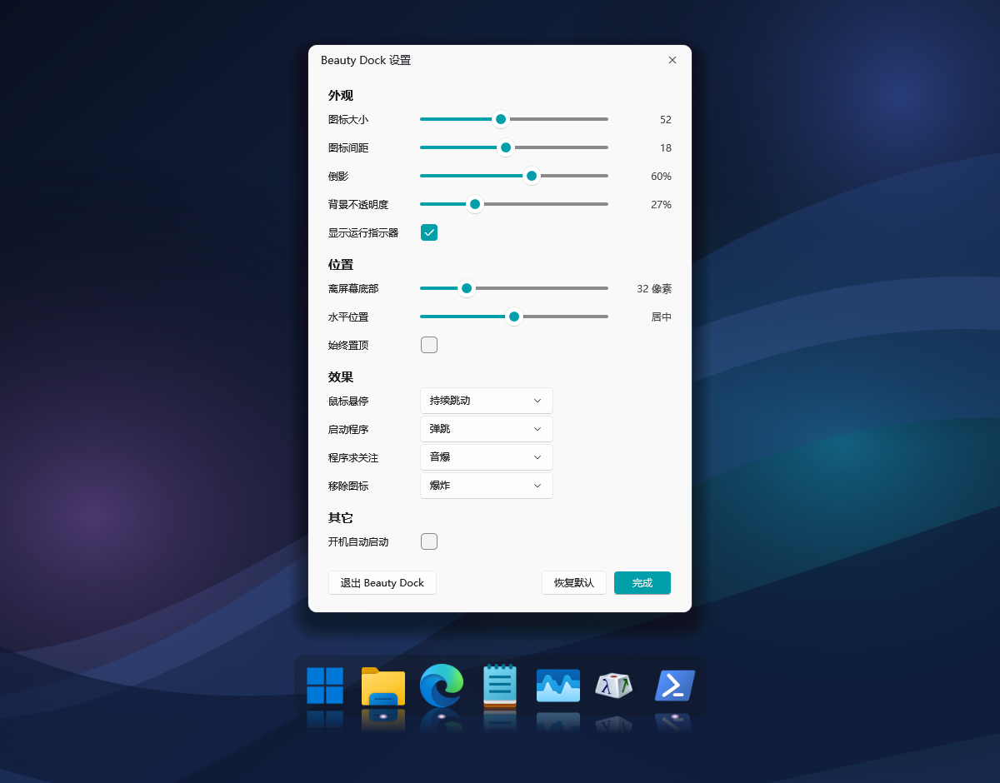

<div align="center">



<h1>Beauty Dock</h1>

<p><b>把常用程序、文件和文件夹放在桌面底部，点一下就能打开或切回。</b></p>

<p>Windows · C# / WPF · .NET 10 · 原生轻量 · 非商业二创</p>

[](https://github.com/YYHSSR/Beauty)
[](https://dotnet.microsoft.com/)
[](https://github.com/YYHSSR/Beauty)
[](https://github.com/YYHSSR/Beauty)
[](LICENSE)

[功能](#功能) · [快速开始](#快速开始) · [操作](#操作) · [配置](#配置) · [开发](#开发) · [许可证](#许可证)

</div>

*预览使用示例图标。背景、图标尺寸、间距、倒影、位置、置顶和登录启动都可以在设置中调整。*

Beauty Dock 是一个常驻桌面底部的快捷停靠栏。它把常用程序、文件、文件夹和 Windows 应用放在一排图标里：单击打开或切换，拖动整理，悬停有动画和倒影。

它不是任务栏的替代品，只是把每天要点的那几个东西放到手边。

## 功能

|  |  |
|:---|:---|
| **🚀 启动与切换**<br><br>单击固定图标打开程序，或切到已打开的窗口；窗口已经在前台时，再点一次会最小化。小圆点表示找到了匹配的应用窗口。 | **🖐️ 拖动整理**<br><br>从资源管理器拖进来即可添加，左右拖动调整顺序。把图标拖出停靠栏再松手，就会移除该快捷入口，原文件仍在原处。 |
| **✨ 动画与倒影**<br><br>悬停或启动程序时，图标弹跳一次，倒影随图标移动；移除图标时播放爆炸动画。 | **🔄 从 Nexus 迁移**<br><br>首次启动会尝试导入已有的 Nexus 快捷入口和部分外观设置。也可以从空的停靠栏开始添加。 |
| **🖥️ 隐藏与恢复**<br><br>桌面空白处右键 →「显示更多选项」→「隐藏 Dock」；隐藏后双击桌面空白处恢复。也可以直接右键 Dock 选择隐藏。 | **⚙️ 配置热重载**<br><br>设置窗口自动保存；手动编辑 JSON 并保存后，Dock 会自动加载有效改动。无效 JSON 不会清空屏幕上已有的图标。 |
| **🪶 原生轻量**<br><br>WPF 绘制界面，Win32 / Windows Shell 获取图标、跟踪窗口和发起启动；无第三方 NuGet 依赖，单实例运行。 | **🔁 多入口**<br><br>多个图标对应同一个可执行文件时，例如两个浏览器用户配置，单击会发起新的启动，使用该图标自己的启动参数。 |

## 贡献者

| 贡献者 | 角色 |
|:---|:---|
| [YYHSSR](https://github.com/YYHSSR) | 作者 · 维护者 |
| [Claude](https://github.com/claude)（Anthropic） | AI 开发协作 |
| [ChatGPT / Codex](https://github.com/codex)（OpenAI） | AI 开发协作 |

> AI 工具仅作为开发协作被致谢，不作为著作权主体。预览图中的 Windows 图标、第三方程序图标和桌面元素归其各自权利人所有。

## 快速开始

在受 .NET 10 支持的 Windows 上安装 [.NET 10 SDK](https://dotnet.microsoft.com/download/dotnet/10.0)，然后在 PowerShell 中执行：

```powershell
git clone https://github.com/YYHSSR/Beauty.git
cd Beauty
dotnet build -c Release
.\bin\Release\net10.0-windows\BeautyDock.exe
```

第一次打开时，如果没有可导入的 Nexus 配置，右键停靠栏的空白点击区，选择 **添加到 Dock…**，或者直接拖入文件。右键选择 **Dock 设置…** 可以调整外观、位置、置顶和登录启动。

在 Beauty Dock 已退出时，用 `BeautyDock.exe --settings` 启动，可以直接打开设置窗口。

重新编译前，请从 **Dock 设置… → 退出 Beauty Dock** 关闭正在运行的实例。

## 操作

| 操作 | 结果 |
|:---|:---|
| 单击图标 | 打开程序或文件，或者切换到已有的应用窗口 |
| 前台窗口时再次单击图标 | 最小化该窗口 |
| `Shift` + 单击 | 重新发起一次启动 |
| 左右拖动图标 | 调整排列顺序 |
| 将图标拖出 Dock 后松手 | 移除 Dock 里的入口，原文件仍在原处 |
| 把程序、快捷方式、文件或文件夹拖进 Dock | 添加入口 |
| 右键图标 → **打开文件所在位置** | 在资源管理器中定位文件 |
| 右键 → **Dock 设置…** | 调整大小、位置、倒影、置顶和登录启动 |
| 桌面空白处右键 → **显示更多选项** → **隐藏 Dock** | 隐藏整排 Dock |
| 双击桌面空白处 | 恢复已隐藏的 Dock |

也可以直接右键 Dock 选择 **隐藏 Dock**。隐藏期间，桌面右键菜单里的 **显示 Dock** 同样可以恢复。

> 隐藏 Dock 不会退出程序。要完全结束进程，请使用 **Dock 设置… → 退出 Beauty Dock**。

## 配置

配置保存在 `%APPDATA%\BeautyDock\config.json`。设置窗口会自动保存；手动编辑 JSON 并保存后，Dock 会自动加载有效改动。运行中读取到无效 JSON 时，屏幕上会保留已有图标。

<details>
<summary>配置示例和常用字段</summary>

```json
{
  "iconSize": 40,
  "iconSpacing": 14,
  "reflection": 0.45,
  "items": [
    { "label": "开始菜单", "path": "::startmenu" },
    { "label": "记事本", "path": "%WINDIR%\\notepad.exe" }
  ]
}
```

| 字段 | 作用 |
|:---|:---|
| `iconSize`、`iconSpacing` | 图标尺寸和间距，随系统缩放 |
| `edgeOffset`、`alignment` | 底部偏移和水平对齐，`alignment` 从 `-100`（最左）到 `100`（最右） |
| `reflection`、`backgroundOpacity` | 倒影比例和背景不透明度，都使用 `0` 到 `1` |
| `topmost`、`showRunningIndicators` | 是否始终置顶、是否显示运行指示器 |
| `items[].arguments`、`items[].workingDir` | 启动参数、工作目录 |
| `items[].icon`、`items[].process` | 自定义图标路径、用于匹配窗口的可执行文件名 |

自定义图标可使用 `.ico`、`.png`、可执行文件，或 `shell:AppsFolder\应用ID` 形式的 Windows 应用路径。

</details>

启动或配置异常时，可检查 `%APPDATA%\BeautyDock\error.log`。启动阶段如果发现 JSON 损坏，会尝试保存一份 `config.broken.json`。

首次启动的 Nexus 导入只读取本机已有的快捷入口和部分外观设置；Nexus 是其权利人的产品，本项目与它无隶属关系。

## 开发

项目使用 WPF 绘制界面，通过 Win32 和 Windows Shell 获取图标、跟踪窗口并发起启动，无第三方 NuGet 依赖。普通用户权限即可运行；登录启动和桌面菜单只写入当前用户注册表。

| 文件 | 职责 |
|:---|:---|
| [`Program.cs`](Program.cs) | 程序入口、单实例与日志 |
| [`DockWindow.cs`](DockWindow.cs) | Dock 布局、交互、启动和配置热重载 |
| [`DockItemView.cs`](DockItemView.cs)、[`Effects.cs`](Effects.cs) | 图标、倒影、运行指示器和动画 |
| [`SettingsWindow.cs`](SettingsWindow.cs)、[`Config.cs`](Config.cs) | 设置界面、JSON 配置和 Nexus 导入 |
| [`Shell.cs`](Shell.cs)、[`Native.cs`](Native.cs) | Shell 图标、快捷方式、窗口跟踪和原生接口 |
| [`DesktopVisibility.cs`](DesktopVisibility.cs) | 桌面右键菜单与双击恢复手势 |
| [`ItemLocator.cs`](ItemLocator.cs) | 定位被移动或重命名的快捷方式目标 |

构建：

```powershell
dotnet build -c Release
.\bin\Release\net10.0-windows\BeautyDock.exe
```

提交问题时，欢迎附上 Windows 版本和复现步骤。粘贴日志前请移除用户名、个人文件路径和启动参数。

## 许可证

Beauty Dock 原创代码、文档、界面和原创素材采用 **Beauty Dock 非商业共享许可证 1.0（BDNCSL-1.0）**。

这是源码公开的非商业共享许可证，**不是 OSI 认可的开源许可证**；允许个人使用、学习、修改和非商业转发，禁止商业使用，并要求署名和相同方式共享。

> 此前版本使用 **Beauty Dock 非商业二次创作许可证 1.0**；当前及后续版本使用本许可证，已发布版本仍按其发布时的许可证处理。

| 内容 | 适用协议 |
|:---|:---|
| Beauty Dock 原创代码、文档、界面和素材 | [Beauty Dock 非商业共享许可证 1.0](LICENSE) |
| .NET 10 / WPF | MIT License |
| Windows 系统图标、Shell 界面元素和相关商标 | Microsoft 及其各自权利人的条款 |
| 预览图中的第三方程序图标与桌面元素 | 归其各自权利人所有，仅用于说明 |

- 本许可证不覆盖 Windows 系统图标、第三方程序图标、.NET / WPF 或其他第三方内容，也不对它们重新授权。
- 商业使用需获得 YYHSSR 的书面许可；第三方内容还需遵守其各自权利人的条款。
- 欢迎以非商业目的使用、修改和分享；再分发时必须保留署名、许可证和修改说明。

### 你可以 / 你必须 / 你不可以

| 你可以 | 你必须 | 你不可以 |
|:---|:---|:---|
| 个人使用、学习、研究、教学 | 保留版权声明与许可证 | 出售、出租、付费分发 |
| Fork、修改、二次创作 | 显著注明来源与作者 | 用于商业产品或商业服务 |
| 非商业转发原版或二创 | 二创继续使用同一许可证 | 设置付费墙或捆绑销售 |
| 分享给朋友 | 标注修改内容与日期 | 暗示作者为你背书 |

### 转发 / 二创署名模板

```text
本项目基于 YYHSSR/Beauty（https://github.com/YYHSSR/Beauty）修改。
原项目采用 Beauty Dock 非商业共享许可证 1.0（BDNCSL-1.0）。
修改内容：……
修改日期：……
```

完整条款见 [LICENSE](LICENSE)。如需商业授权，请通过 GitHub 联系 [@YYHSSR](https://github.com/YYHSSR)。

## 免责声明

Beauty Dock 会启动你添加的程序、读取图标和窗口信息、写入用户配置及当前用户注册表，并可能隐藏或显示 Dock。请只添加你信任的快捷方式，并在修改配置前备份 `config.json`。

本项目不是 Microsoft 或任何第三方公司的官方产品，也未获得其认可或背书。软件按“现状”提供，不附带任何明示或暗示的担保。

---

<div align="center">

如果 Beauty Dock 让你的桌面顺手一点，点个 ⭐ 支持一下。

Made with care by [YYHSSR](https://github.com/YYHSSR)

</div>
